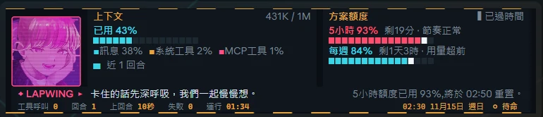

# Icanfixthat HUD

繁體中文 | [English](docs/README.en.md)

為 Claude Code 打造的夜城風格 HUD，顯示在輸入提示上方的資訊區。



```
┌ ─ ─ ─ ─ ─ ─ ─ ─ ─ ─ ─ ─ ─ ─ ─ ─ ─ ─ ─ ─ ─ ─ ─ ─ ─ ─ ─ ─ ─ ─ ─ ─ ─ ─ ┐
  ┌──────┐ 上下文      109K / 1M  方案額度     █ 已過時間  每回合工具
  │ 頭像 │ 已用 11%               5小時 96% 剩2時10分 · 用量超前  峰值 1 平均 1
  │      │ ████████░░░░░░░░       ██████████████░█     ▁▁▅█▁
  │      │ ■訊息 5% ■系統工具 2%  每週 38% 剩3天5時 · 節奏正常    近 10 回合
  └──────┘ ▁▂▂▃ 近 4 回合          ██████░░░░░░░░░░
  ◆ LAPWING ▸ 5小時額度已用 96%,將於 00:30 重置。
  工具呼叫 0  回合 10  上回合 3秒  失敗 0  運行 00:14     22:23 11月13日 週五 ○ 待命
└ ─ ─ ─ ─ ─ ─ ─ ─ ─ ─ ─ ─ ─ ─ ─ ─ ─ ─ ─ ─ ─ ─ ─ ─ ─ ─ ─ ─ ─ ─ ─ ─ ─ ─ ┘
```

| 區塊 | 顯示內容 |
| --- | --- |
| 頭像 | 角色頭像；尚未加入圖片時顯示「無訊號」外框 |
| 上下文 | 上下文視窗使用量、主要類別，以及最近 8 回合結束後的用量趨勢圖 |
| 方案額度 | 5 小時與每週額度的使用量、代表已過時間的白色標記、剩餘時間，以及用量是否超前或低於時間進度 |
| 每回合工具 | 最近 10 回合的工具呼叫峰值、平均值與趨勢圖 |
| 狀態列 | 左側顯示 `◆ <名稱> ▸` 與關心語句；右側顯示 5 小時用量，執行時則顯示 `處理中…` |
| 底列 | 工具呼叫數、回合數、上回合耗時、失敗次數、運行時間、時鐘，以及 `○ 待命` / `● 運作中` |

支援終端機、桌面版、VS Code 與行動版，介面標示皆為繁體中文。HUD 資訊區固定占用 9 列，另有一列「外觀」入口，各區塊依應用程式設定的聊天欄寬度並排。寬度不足時會先隱藏工具欄，再隱藏額度欄；可用高度少於 9 列時，只顯示兩列狀態資訊。

進度條以間隔排列的色格（`▌`）呈現在深色底軌上。上下文依類別分為青色、琥珀色與粉色；5 小時額度為紅色，每週額度為青色，白色標記代表已過時間。欄位由左至右依序為上下文、工具與額度：右側額度欄占 31%，工具欄占 22%，其餘空間留給上下文。

在支援 SVG 的介面（桌面版、VS Code、行動版）中，HUD 上下方會顯示與外框同色的琥珀色警示帶：高 2 px，每段長 144 px、間隔 144 px，對齊整數像素。進度條色格寬 8 px、間隔 1.4 px；計數器與時鐘字級為 11 px。頭像框為 99×100，圖片會裁切填滿，不會拉伸。終端機則使用琥珀色圓角外框、`▌` 色格與終端機本身的字型。

狀態列像是一段小小的對話：左側角色會從 12 句關心語句中輪替，每 10 分鐘換一句；可在 [`hooks/persona.ts`](hooks/persona.ts) 的 `CARE_LINES` 修改。右側顯示 5 小時用量，回合執行中則顯示 `處理中…`。

支援 SVG 的介面與支援圖片的終端機皆可顯示頭像。文字沿用應用程式本身的字型：在 Claude Code 2.1.325 中，hooks 模組無法自行指定字型（`Text` 的 `mono` 與 `size` 會在執行時被拒絕）。

## 安裝

在 Claude Code 輸入：

```
/plugin install icanfixthat-hud --marketplace xiangerwu/claude-theme-icanfixthat
```

輸入 `y` 加入 marketplace，再選擇安裝範圍。

## 夜城外觀控制（0.3.0）

HUD 上方的「◈ 外觀」開啟 Claude 原生面板；關閉 HUD 後入口仍保留，Esc 或關閉按鈕可收起面板。

- 遠方大樓與窗燈、格線、霧玻璃／雨滴依遠到近排列。大樓採縮小輪廓、低對比與薄霧。
- 可開關大樓、雨景、霧玻璃、右上光源、掃描線、HUD 與雨景／邊框動畫。
- 可調雨量、速度、霧化、光源亮度／`#RRGGBB` 色碼、掃描週期與 HUD 寬度（80–100%）。數值與色碼輸入後按 Enter 套用；不支援 Codex 的 HTML 色彩選擇器／滑桿，使用原生輸入欄。
- 設定透過 Claude `config.set` 保存到本外掛的 `appearance` 選項，不依賴 Codex 的設定。恢復預設會重設外觀，不改角色名稱。
- 雨景預設關閉。動畫例外預設關閉，系統減少動畫時停止掃描、雨景與邊框；明確開啟動畫選項後只對本主題例外。
- 背景 renderer 僅供桌面與行動版；終端機保留 HUD／控制面板。行動版宿主不提供面板背後的原生 blur，場景內的 SVG 霧化仍由主題處理。

驗證範圍：Claude Code 2.1.325 的 `plugin test` 驅動實際 hooks／元件樹，共 14 項測試通過；尚未完成 Claude 桌面實機畫面驗收。

## 自訂外觀

預設角色名稱為 **LAPWING**，頭像框為空。

- **名稱**：在外掛設定選單，或 `settings.json` → `pluginConfigs["icanfixthat-hud"].options.persona_name` 設定 `persona_name`。留空便不顯示名稱。
- **頭像**：將圖片放在 `assets/portrait.jpg`（建議約 256×320，供桌面版、VS Code 與行動版使用，會覆蓋粉色掃描線）及 `assets/portrait.png`（建議約 128×160，供支援圖片的終端機使用）。圖片會在工作階段開始時讀取，且已由 Git 忽略，不會隨 repo 散布你的個人使用圖片。未提供圖片時，HUD 會顯示「NO SIGNAL」外框。
- **配色**：修改 [`hooks/register.tsx`](hooks/register.tsx) 頂部的 `C` 物件。

## 開發

啟動 Claude Code，載入並監看本地資料夾：

```
claude --plugin-dir /path/to/claude_theme_Icanfixthat
```

桌面版請在 `~/.claude/settings.json` 的 `env` 區塊中，以 `CLAUDE_CODE_PLUGIN_DIRS` 指定資料夾。

驗證與測試：

```
claude plugin validate .
claude plugin test .
```

目錄結構：

```
.claude-plugin/plugin.json       外掛資訊與 persona_name 選項
.claude-plugin/marketplace.json  讓此 repo 可透過 marketplace 安裝
hooks/register.tsx              hooks 與 HUD 資訊區
hooks/format.ts                 格式化工具（進度條、用量節奏、時鐘）
hooks/persona.ts                頭像框與預設占位畫面
assets/                         個人 portrait.jpg / portrait.png（Git 忽略）
types/index.d.ts                共用型別
tests/hud.test.tsx              工具函式與畫面渲染測試
```

## 注意事項

- 方案額度僅適用於 Claude 訂閱；使用 API key 時，該欄會顯示沒有可用讀值。
- 本專案以 Claude Code 2.1.325 建置與測試。該版本執行時缺少 `$.state`，因此計數器保存在模組內，外掛熱重載時會重新計算；用量資料則會立即恢復。
- 該版本的測試工具會忽略 `test(name, { options }, body)`，因此自訂角色名稱的路徑尚未有測試涵蓋。

## 授權

程式碼採用 [MIT 授權](LICENSE)。

## 圖片來源

範例截圖中的頭像繪師：**@kuzuko0503**。圖片版權屬於原作者，不適用於本 repo 的 MIT 授權，此處僅標示來源。頭像檔案本身（`assets/portrait.*`）未包含在 repo 中。
