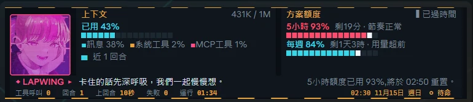

# Icanfixthat HUD

[繁體中文](../README.md) | English

A night-city HUD for Claude Code, drawn in the band above the prompt.



```
┌ ─ ─ ─ ─ ─ ─ ─ ─ ─ ─ ─ ─ ─ ─ ─ ─ ─ ─ ─ ─ ─ ─ ─ ─ ─ ─ ─ ─ ─ ─ ─ ─ ─ ─ ┐
  ┌──────┐ 上下文      109K / 1M  方案額度     █ 已過時間  每回合工具
  │ 頭像 │ 已用 11%               5小時 96% 剩2時10分 · 用量超前  峰值 1 平均 1
  │      │ ████████░░░░░░░░       ██████████████░█     ▁▁▅█▁
  │      │ ■訊息 5% ■系統工具 2%  每週 38% 剩3天5時 · 節奏正常    近 10 回合
  └──────┘ ▁▂▂▃ 近 4 回合          ██████░░░░░░░░░░
  ◆ LAPWING ▸ 5小時額度已用 96%,將於 00:30 重置。
  工具呼叫 0  回合 10  上回合 3秒  失敗 0  運行 00:14     22:23 11月13日 週五 ○ 待命
└ ─ ─ ─ ─ ─ ─ ─ ─ ─ ─ ─ ─ ─ ─ ─ ─ ─ ─ ─ ─ ─ ─ ─ ─ ─ ─ ─ ─ ─ ─ ─ ─ ─ ─ ┘
```

| Column | Shows |
| --- | --- |
| Portrait | A persona portrait (an empty 「無訊號」 frame until you add one) |
| Context | Fill of the context window, its top categories, and a sparkline of the fill after each of the last 8 turns |
| Plan limits | The 5-hour and weekly windows: use, a white cell inside the bar for how much of the window has passed, time left, and whether use runs ahead of or under pace |
| Tool calls per turn | Peak and average over the last 10 turns, as a sparkline |
| Status line | `◆ <name> ▸` and a caring line on the left; the 5-hour use (or `處理中…`) on the right |
| Footer | Tool calls, turns, last turn's length, failed calls, uptime, clock, and `○ 待命` / `● 運作中` |

It draws in the terminal, the desktop app, VS Code and the mobile app, labelled in Traditional Chinese, and never scrolls: the whole HUD takes 9 rows, laid side by side across the band's width (the chat column's, which the app sets). Narrow, the tool column steps aside, then the limits column; with fewer than 9 rows, only the two-row status strip shows.

Bars are spaced cells (`▌`) on a dark track that sinks into the panel: the context bar split by category (cyan, amber, pink), the 5-hour bar in red, the weekly bar in cyan, with a white cell for the time gone. Columns run context, tools, limits: the limits column holds the right edge (31%), the tools sit before it (22%), and the context takes the rest.

Where the surface draws SVG (desktop, VS Code, mobile), a thin caution tape in the frame's amber runs above and below the HUD (2 px tall, 144 px dashes 144 px apart, drawn on whole pixels), bars are exact cells (8 px wide, 1.4 px apart), the counters and clock are set in small type (11 px), and the portrait frame is 99×100, the picture cropped to fill it, never stretched. The terminal keeps a rounded amber border, `▌` cells and its own type.

The status strip is a little conversation: on the left, the persona says one of twelve caring lines (a new one every ten minutes; edit `CARE_LINES` in [`hooks/persona.ts`](../hooks/persona.ts)); on the right, the 5-hour use, or `處理中…` while a turn runs.

The portrait is drawn wherever the surface has SVG, and as a picture in terminals that draw images. The text takes the app's own font: on Claude Code 2.1.325 a hooks module cannot choose one (`Text`'s `mono` and `size` are refused at run time).

## Install

At a Claude Code prompt:

```
/plugin install icanfixthat-hud --marketplace xiangerwu/claude-theme-icanfixthat
```

Answer `y` to add the marketplace, then pick a scope.

## Make it yours

The persona ships as **LAPWING** with an empty portrait frame.

- **Name**: set `persona_name` in the plugin's options (the config menu, or `settings.json` → `pluginConfigs["icanfixthat-hud"].options.persona_name`). Empty shows no name.
- **Portrait**: put your picture at `assets/portrait.jpg` (about 256×320, used by the desktop, VS Code and mobile apps, under a pink scanline veil) and `assets/portrait.png` (about 128×160, used by terminals that draw images). They are read when a session starts and are git-ignored, so art you may use yourself is never redistributed with the repository. Without them the HUD draws a "NO SIGNAL" frame.
- **Colors**: the palette is the `C` object at the top of [`hooks/register.tsx`](../hooks/register.tsx).

## Develop

Run Claude Code with the folder loaded and watched:

```
claude --plugin-dir /path/to/codex_theme_Icanfixthat
```

For the desktop app, name the folder in `CLAUDE_CODE_PLUGIN_DIRS` (in the `env` block of `~/.claude/settings.json`).

```
claude plugin validate .
claude plugin test .
```

Layout:

```
.claude-plugin/plugin.json       manifest and the persona_name option
.claude-plugin/marketplace.json  makes this repository installable
hooks/register.tsx               the hooks and the band
hooks/format.ts                  pure formatting helpers (bars, pace, clock)
hooks/persona.ts                 portrait frame and placeholder
assets/                          your portrait.jpg / portrait.png (git-ignored)
types/index.d.ts                 shared types
tests/hud.test.tsx               helper and render tests
```

## Notes

- Plan limits show only on a Claude subscription; with an API key the column says there are no readings.
- Built and tested against Claude Code 2.1.325. On that build `$.state` is missing at run time, so the counters live in the module and start over when the plugin hot-reloads. The usage figures come straight back.
- On that build the test kit ignores `test(name, { options }, body)`, so the named-persona path is not covered by a test yet.

## License

The code is under the [MIT License](../LICENSE).

## Credits

Portrait art in the example screenshot: **@kuzuko0503**. The artwork belongs to the artist and is not covered by this repository's MIT License. It is shown here with credit only. The portrait files themselves (`assets/portrait.*`) are not part of the repository.

## Night-city controls (0.3.0)

Use **◈ 外觀** above the HUD to open the native Claude pane. It remains available with the HUD hidden; Escape or Close dismisses it. Settings persist through the plugin's `appearance` configuration field.

The distant city/windows sit behind the lattice, then frosted glass/rain. Controls cover buildings, rain amount/speed, glass strength, upper-right light brightness/hex color, scan period, HUD visibility/width (80–100%), animation and reset. Claude uses native Select/Input controls rather than HTML sliders/color pickers; submit numeric and `#RRGGBB` fields with Enter. Claude's own telemetry remains the HUD data source.

Rain and the animation override default off. Reduced motion pauses rain, the border and the scan until the theme-only override is enabled. Backdrops render on desktop/mobile, not in the terminal. Mobile lacks the host panel backdrop blur; the scene's SVG blur still applies.

Validated with 14 real hook/component-tree tests on Claude Code 2.1.325. Live Claude desktop appearance is not yet verified. Source backup: local ignored `backup-0.2.0-appearance/`.
